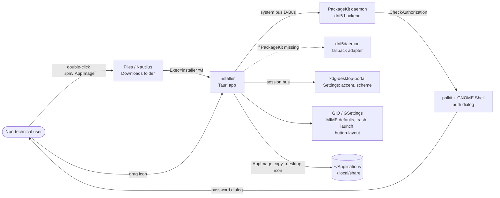
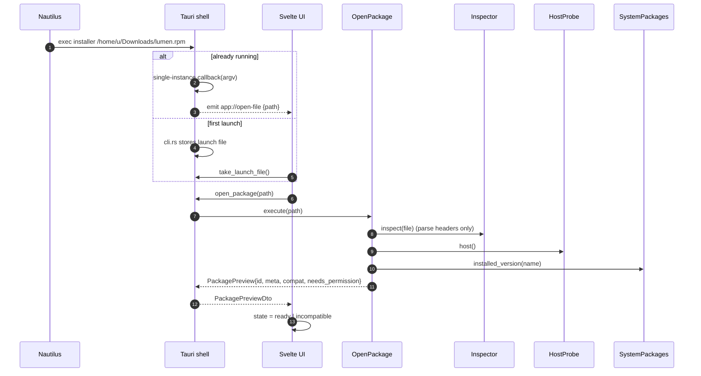
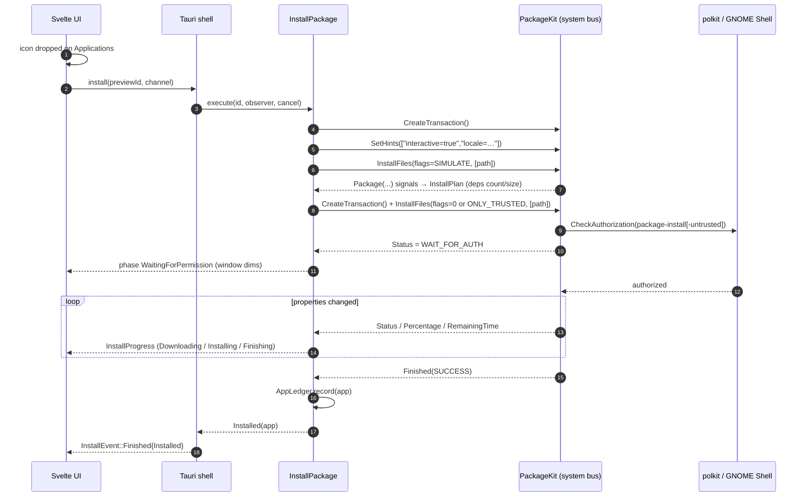

# Architecture Map

> The source of truth for how the installer is put together. If code and this document disagree, fix one of them in the same PR.
> Related: [folder-structure.md](folder-structure.md) · [ipc-contract.md](ipc-contract.md) · [state-machines.md](state-machines.md) · [ADRs](../adr/) · [Features](../product/FEATURES.md)

## 1. What we are building

A macOS-style "drag to Applications" installer for Linux. A user double-clicks a downloaded **.rpm**, **AppImage** or (later) **.deb** file. A small window opens with the app icon on the left and an Applications folder on the right, and the user drags the icon across. No terminal, no file paths, no package-manager names.

| | |
|---|---|
| **Primary target** | Fedora Workstation 45 (GNOME 51, Wayland only). Fedora 44 (GNOME 50) is the minimum we support. |
| **Later target** | Ubuntu 26.04 LTS and later (`.deb`). The architecture supports it from day one; it gets tested and shipped later. |
| **Shell** | Tauri 2: a Rust core plus a WebKitGTK 4.1 webview |
| **UI** | SvelteKit (SPA mode, `adapter-static`), Svelte 5 runes, TypeScript (strict) |
| **Look** | Apple HIG / AppKit-inspired. Window controls follow GNOME's `button-layout` setting ([ADR-0006](../adr/0006-window-controls-follow-gnome-layout.md)). |

## 2. Guiding principles

1. **Clean Architecture (ports and adapters).** Business rules don't know about Tauri, D-Bus, the file system or Svelte. Dependencies point inward only.
2. **Never execute untrusted input.** Packages are parsed, never run, while we inspect them. AppImages are read as SquashFS from Rust ([ADR-0005](../adr/0005-inspect-appimages-without-executing.md)).
3. **The system owns privilege.** Root operations go through PackageKit, and polkit shows its own password dialog. The app never sees a password ([ADR-0007](../adr/0007-polkit-owns-authentication.md)).
4. **Plain language at the edge.** Technical states become human phrases in exactly one place: the frontend `copy` module, fed by typed domain enums ([docs/design/COPY.md](../design/COPY.md)).
5. **Fake everything for the UI.** Every gateway has an in-browser mock, so designers and Playwright can run the full flow in a plain browser, as the prototype does.

## 3. System context



## 4. Layers and the dependency rule

```
                ┌───────────────────────────────────────────────┐
                │ Frameworks & drivers                          │
                │  Tauri runtime · WebKitGTK · zbus · GIO       │
                │  backhand · rpm crate · fs                    │
                │   ┌───────────────────────────────────────┐   │
                │   │ Interface adapters                    │   │
                │   │  Rust: tauri commands, event emitter, │   │
                │   │        DTO mapping (src-tauri/src)    │   │
                │   │  TS:   gateways (tauri / mock)        │   │
                │   │   ┌───────────────────────────────┐   │   │
                │   │   │ Application (use cases)       │   │   │
                │   │   │  OpenPackage, InstallPackage, │   │   │
                │   │   │  Uninstall, MakeDefault …     │   │   │
                │   │   │  + port traits                │   │   │
                │   │   │   ┌───────────────────────┐   │   │   │
                │   │   │   │ Domain                │   │   │   │
                │   │   │   │  Package, Compat,     │   │   │   │
                │   │   │   │  InstallPhase, errors │   │   │   │
                │   │   │   └───────────────────────┘   │   │   │
                │   │   └───────────────────────────────┘   │   │
                │   └───────────────────────────────────────┘   │
                └───────────────────────────────────────────────┘
                       source-code dependencies point INWARD
```

Each layer is its own Cargo crate, so the compiler enforces the rule:

| Crate | Path | May depend on | Must NOT depend on |
|---|---|---|---|
| `installer-domain` | `src-tauri/crates/domain` | `serde`, `thiserror` | anything with IO, `tokio`, `tauri`, `zbus` |
| `installer-application` | `src-tauri/crates/application` | domain, `async-trait`/`trait-variant`, `tracing` | `tauri`, `zbus`, `gio`, `std::fs` |
| `installer-infrastructure` | `src-tauri/crates/infrastructure` | domain, application (to implement ports), `zbus`, `ashpd`, `gio`, `backhand`, `rpm`, `tokio` | `tauri` |
| `installer` (app shell) | `src-tauri` (bin + lib) | all of the above plus `tauri` and its plugins | none (this is the **composition root**) |

The frontend mirrors this structure (see [folder-structure.md](folder-structure.md#frontend)):

| TS layer | Path | Rule |
|---|---|---|
| domain | `src/lib/core/domain` | Pure TS. No Svelte, no `@tauri-apps/*`. Types, state machine reducers, formatting. |
| ports | `src/lib/core/ports` | Interfaces only (`InstallerGateway`, `AppearanceGateway`, …) |
| application | `src/lib/features/*/*.svelte.ts` | Controllers: classes holding `$state` that call ports. No direct `invoke`. |
| infrastructure | `src/lib/infrastructure/{tauri,mock}` | The only place that imports `@tauri-apps/api` |
| ui | `src/lib/ui`, `src/lib/features/*/*.svelte` | Components. They talk to controllers, never to gateways. |
| composition | `src/routes/+layout.svelte` + `src/lib/app/context.ts` | Picks the Tauri or mock gateways and provides them through Svelte context |

## 5. Domain model (Rust, `installer-domain`)

```mermaid
classDiagram
    class PackageFile { path: PathBuf; format: PackageFormat; size_bytes: u64 }
    class PackageFormat { <<enum>> Rpm; Deb; AppImage }
    class PackageMetadata {
      name: String  // machine name, e.g. lumen-notes
      display_name: String
      version: Version
      arch: Arch
      summary: Option~String~
      icon: Option~IconData~
      scope: InstallScope
    }
    class InstallScope { <<enum>> System; User }
    class HostSystem { family: DistroFamily; distro_name: String; version_id: String; arch: Arch; has_fuse2: bool }
    class DistroFamily { <<enum>> RpmBased; DebBased; Other }
    class Compatibility { <<enum>> Ok; WrongFamily(made_for); WrongArch; AlreadyInstalled(VersionRelation); MissingRuntime(what) }
    class PackagePreview { id: PreviewId; meta: PackageMetadata; compat: Compatibility; needs_permission: bool }
    class InstallPhase { <<enum>> Preparing; WaitingForPermission; Downloading; Installing; Finishing }
    class InstallProgress { phase; percent: Option~u8~; eta_secs: Option~u32~ }
    class InstallOutcome { <<enum>> Installed(InstalledApp); Cancelled; Failed(InstallError) }
    class InstalledApp { id: AppId; display_name; version; icon; source: AppSource; installed_at; desktop_id: Option~String~ }
    class InstallError { <<enum>> PermissionDenied; Offline; MissingDependencies; Conflicts; NotEnoughSpace; CorruptFile; UntrustedSource; BackendUnavailable; Unknown(code) }

    PackageFile --> PackageFormat
    PackagePreview --> PackageMetadata
    PackagePreview --> Compatibility
    PackageMetadata --> InstallScope
    InstallProgress --> InstallPhase
    InstallOutcome --> InstalledApp
    InstallOutcome --> InstallError
```



Rules that live in the domain as pure functions, each with unit tests:

- `PackageFormat::sniff(header: &[u8], file_name) -> Option<PackageFormat>` checks the magic bytes first (RPM lead `ED AB EE DB`, `!<arch>\ndebian-binary`, AppImage `AI\x02` at offset 8) and uses the file extension only as a hint.
- `Compatibility::evaluate(&PackageMetadata, &HostSystem, installed: Option<Version>)`
- `InstallScope::for_format(format)`: Rpm/Deb → System, AppImage → User
- `Version` comparison: an rpmvercmp-compatible ordering, plus a Debian ordering for later
- `AppId::from_name(display_name)`: a slug that is safe in file names and desktop IDs
- Error classification: what a user can do about each error (retry, cancel, get help)

> **As built (W0, decision D-011):** `PackageMetadata` also carries `format` and `needs_fuse2`. `InstalledApp` also carries `name` (machine name) and `path`, and `installed_at` is Unix seconds (ISO-8601 on the wire). `InstallError` adds `Cancelled`, `NotFound` and `Busy`. `Compatibility` adds `Unsupported(reason)`. The code in `installer-domain` is authoritative.

## 6. Application layer: use cases and ports

### Use cases (`installer-application/src/use_cases/`)

| Use case | Input | Output | Ports used |
|---|---|---|---|
| `OpenPackage` | `PathBuf` | `PackagePreview` (stored in the `PreviewRegistry` under a `PreviewId`) | `PackageInspector` (per format), `HostProbe`, `SystemPackages::installed_version`, `AppLedger` |
| `InstallPackage` | `PreviewId`, `InstallObserver` | `InstallOutcome` | `SystemPackages` or `UserApps`, `DesktopIntegration`, `AppLedger`, `InstallObserver` |
| `CancelInstall` | `PreviewId` | `()` | `SystemPackages::cancel` / cancellation token |
| `ListInstalledApps` | none | `Vec<InstalledApp>` | `AppLedger`, `UserApps::scan`, `SystemPackages::installed_version` (to reconcile) |
| `UninstallApp` | `AppId` | `UninstallOutcome` | `UserApps::trash` or `SystemPackages::remove`, `DesktopIntegration`, `AppLedger` |
| `LaunchApp` | `AppId` | `()` | `Launcher` |
| `GetDefaultHandlerStatus` / `MakeDefaultHandler` | none | `DefaultStatus` | `DefaultHandlerRegistry` |
| `GetAppearance` + `WatchAppearance` | none | `Appearance` (button layout, accent, scheme, reduced motion, high contrast) | `AppearanceSource` |

### Ports (traits, `installer-application/src/ports/`)

```rust
#[trait_variant::make(Send)]
pub trait PackageInspector {
    fn supports(&self, format: PackageFormat) -> bool;
    async fn inspect(&self, file: &PackageFile) -> Result<PackageMetadata, InspectError>;
}

#[trait_variant::make(Send)]
pub trait SystemPackages {               // PackageKit (primary) | dnf5daemon (fallback)
    async fn installed_version(&self, name: &str) -> Result<Option<Version>, BackendError>;
    async fn plan(&self, file: &PackageFile) -> Result<InstallPlan, BackendError>;  // simulate
    async fn install(&self, file: &PackageFile, obs: &dyn InstallObserver, cancel: CancelToken)
        -> Result<(), InstallError>;
    async fn remove(&self, name: &str, obs: &dyn InstallObserver) -> Result<(), InstallError>;
}

#[trait_variant::make(Send)]
pub trait UserApps {                     // AppImage store in ~/Applications
    async fn install(&self, file: &PackageFile, meta: &PackageMetadata) -> Result<PathBuf, InstallError>;
    async fn trash(&self, app: &InstalledApp) -> Result<(), InstallError>;
    async fn scan(&self) -> Result<Vec<InstalledApp>, InstallError>;
}

pub trait InstallObserver: Send + Sync { fn on_progress(&self, p: InstallProgress); }
pub trait HostProbe { fn host(&self) -> HostSystem; }
pub trait DesktopIntegration { /* write/remove .desktop + icons, refresh caches */ }
pub trait DefaultHandlerRegistry { /* is_default(mimes), make_default(mimes) */ }
pub trait AppLedger { /* record/forget/list apps installed through us (JSON) */ }
pub trait Launcher { /* launch a desktop id */ }
pub trait AppearanceSource { /* snapshot + change stream */ }
```

> **As built (W0, D-011):** extra ports `FileProbe` (reads the file head for sniffing) and `Clock`; `InstallObserver::on_plan(&InstallPlan)`; `DefaultHandlerRegistry::dismiss_prompt`. Async ports use native `async fn` + `trait_variant::make(Send)` and are used through generics, not `dyn` (see the `rust-clean-architecture` skill). `CancelToken` is `tokio_util::sync::CancellationToken`.

> Async traits (decided in W0): native `async fn` in traits with `trait_variant::make(Send)`. Async ports are not object safe, so use cases are generic over their ports. Only the sync observer ports are `dyn`. `async_trait` is not used. Details are in ADR-0003 and the skill [`rust-clean-architecture`](../../.claude/skills/rust-clean-architecture/SKILL.md).

## 7. Infrastructure adapters (`installer-infrastructure`)

| Module | Implements | Technology | Notes |
|---|---|---|---|
| `inspect/rpm.rs` | `PackageInspector` | `rpm` crate (reads headers only) | Name, version, arch, summary. Icon: v1 shows a generic icon; v1.x pulls `hicolor` PNG/SVG or AppStream metainfo out of the payload |
| `inspect/deb.rs` | `PackageInspector` | `ar` + `tar` + `xz2`/`zstd` | Reads `control`. Later milestone |
| `inspect/appimage.rs` | `PackageInspector` | ELF section header math (`goblin` or a manual parse) to find the SquashFS offset, then `backhand` | Reads the root `*.desktop`, `.DirIcon` (follow symlinks inside the image only) and `usr/share/metainfo`. Never runs the file. Type-1 (ISO) and DwarFS images → `Unsupported` |
| `host/os_release.rs` | `HostProbe` | `/etc/os-release` (`ID`, `ID_LIKE`, `VERSION_ID`), `uname`-style arch, checks `libfuse.so.2` | |
| `packagekit/` | `SystemPackages` | `zbus` proxies on the **system bus** | See section 9. Primary on Fedora and Ubuntu |
| `dnf5daemon/` | `SystemPackages` | `zbus`, `org.rpm.dnf.v0` | Fallback when `org.freedesktop.PackageKit` can't be activated ([ADR-0004](../adr/0004-packagekit-primary-dnf5daemon-fallback.md)). Built behind a cargo feature |
| `appimage_store.rs` | `UserApps` | `std::fs`, `gio::File::trash` | Copies to `~/Applications/<Name>.AppImage` (atomic: temp file + rename), `0755`, moves to the freedesktop Trash on uninstall |
| `desktop_entries.rs` | `DesktopIntegration` | Write `~/.local/share/applications/<app-prefix>.<slug>.desktop` and `~/.local/share/icons/hicolor/<size>/apps/` | We **generate** the entry from scratch; we never copy the embedded `Exec=`. Run `update-desktop-database` if present |
| `defaults.rs` | `DefaultHandlerRegistry` | `gio::AppInfo::set_as_default_for_type` / `default_for_type` | Same effect as `xdg-mime default`, without spawning a process |
| `ledger.rs` | `AppLedger` | JSON at `$XDG_DATA_HOME/<app-id>/ledger.json` | Atomic write; versioned schema |
| `launcher.rs` | `Launcher` | `gio::DesktopAppInfo::launch` | |
| `appearance.rs` | `AppearanceSource` | `ashpd` Settings portal (`org.freedesktop.appearance`: `color-scheme`, `accent-color`, `contrast`) + `gtk::Settings::gtk_decoration_layout()` (GDK on Wayland reads `org.gnome.desktop.wm.preferences button-layout`) + `org.gnome.desktop.interface enable-animations` | Emits a change stream. The portal does **not** expose `button-layout` (xdg-desktop-portal-gnome#95), so read it from GTK/GSettings directly |

## 8. Interface adapters: the Tauri shell (`src-tauri/src`)

```
src-tauri/src/
├─ main.rs            # fn main() { installer_lib::run() }
├─ lib.rs             # run(): Builder, plugins, setup, manage(AppState), invoke_handler
├─ composition.rs     # builds adapters → use cases (the ONLY place that names concrete types)
├─ state.rs           # AppState { use cases, PreviewRegistry, active install handles }
├─ commands/          # thin #[tauri::command] fns: DTO in → use case → DTO out
│  ├─ package.rs      # open_package, take_launch_file
│  ├─ install.rs      # install, cancel_install
│  ├─ library.rs      # list_installed, uninstall, launch_app
│  ├─ defaults.rs     # default_handler_status, make_default_handler
│  └─ appearance.rs   # get_appearance
├─ events.rs          # TauriInstallObserver: InstallObserver → Channel/emit
├─ dto.rs             # serde + specta types; From<domain> impls
├─ error.rs           # CommandError: serializable, with a stable `code`
└─ cli.rs             # argv parsing + single-instance forwarding
```

Rules:
- A command body has **no logic** beyond mapping (≈10 lines). Anything more belongs in a use case.
- Commands return `Result<Dto, CommandError>`. `CommandError` is `{ code: ErrorCode, detail?: string }`. The frontend switches on `code`, never on message text.
- Progress streams through **`tauri::ipc::Channel<InstallEvent>`**, passed in by the `install` command. A Channel is scoped to one call, ordered and fast. Global events (`emit`) are used only for app-wide notices: `app://open-file` and `appearance://changed`.
- TS bindings are **generated** with `tauri-specta` into `src/lib/infrastructure/tauri/bindings.ts`. That file is committed, and CI checks it is up to date ([ADR-0009](../adr/0009-generated-typed-ipc.md)).

Plugins: `tauri-plugin-single-instance` (registered first), `tauri-plugin-log` (or a plain `tracing` subscriber). There is **no** shell plugin, **no** fs plugin and **no** http plugin, so the frontend can't touch the system except through our commands.

## 9. Key flows

### 9.1 Opening a package (double-click in Files)



### 9.1a Files that are not a known package

`open_package` sniffs the file by content. A file with no known magic bytes (for example an HTML page saved as `.rpm`) is rejected with `CommandError{code: corruptFile}`. No preview is created, and the UI shows the "damaged or isn't an app package" message. A recognised format that this version cannot read (Type-1 AppImage, DwarFS) is different: it gets a preview with `Compatibility.unsupported`.

### 9.2 Installing an .rpm (system scope)



Phase order is fixed. System scope emits `Preparing → WaitingForPermission → Downloading/Installing → Finishing`. User scope (AppImage) emits `Preparing → Installing → Finishing` and never `WaitingForPermission`. The UI machine never goes from installing back to awaiting.

Until the PackageKit adapter lands, the shell wires `SystemPackages` to an "unavailable" stub: `installed_version` returns `Ok(None)` and `install` returns `Err(BackendUnavailable)`. The AppImage path is fully real. Fakes in `application::testing` may be wired the same way, only from clearly named `composition::fake_*` functions.

If polkit is dismissed, the result is `ErrorCode(NOT_AUTHORIZED)` or `Finished(CANCELLED)`, which maps to `InstallOutcome::Cancelled`. The UI quietly springs the icon back. That is not an error state.

### 9.3 Installing an AppImage (user scope, no password)

1. `UserApps::install`: copy to `~/Applications/.<name>.partial`, fsync, rename to `<Name>.AppImage`, chmod `0755`.
2. `DesktopIntegration`: write icon(s) and a generated `.desktop` (`Exec="<abs path>" %U`, `TryExec`, `Icon=<our icon id>`, `X-Installer-Managed=true`).
3. `AppLedger.record`, then `Installed(app)`.
4. If `HostSystem.has_fuse2 == false` and the runtime is a legacy dynamic one, the compatibility check shows `MissingRuntime("fuse2")` **before** the drag, with a plain-language explanation.

### 9.4 Uninstall ("Move to Trash")

- AppImage: `gio` trash (recoverable), then remove the `.desktop` and icons, then `ledger.forget`.
- System package: PackageKit `RemovePackages(flags, [package_id], allow_deps=false, autoremove=true)`. polkit prompts. If removal would take other packages with it, show a confirmation that names them in plain words.
- Only apps that **we** installed (they are in the ledger) are removable from our UI in v1.

## 10. Frontend runtime architecture

```mermaid
flowchart TB
    subgraph routes
      L[+layout.svelte<br/>providers, appearance, window chrome]
      R0[/ +page.svelte<br/>router: launch file? → install : library/]
      R1[/install/[[previewId]]]
      R2[/library]
    end
    subgraph features
      F1[installer/<br/>InstallerController.svelte.ts<br/>DmgWindow, DragIcon, AppFolder, ProgressView, DoneView, PermissionShade]
      F2[library/<br/>LibraryController.svelte.ts<br/>AppGrid, AppTile, TrashConfirm]
      F3[default-handler/<br/>DefaultPromptSheet]
      F4[appearance/<br/>AppearanceStore → CSS vars]
    end
    subgraph core
      D[domain: types, installerMachine, copy]
      P[ports: InstallerGateway, LibraryGateway, AppearanceGateway, WindowGateway]
    end
    subgraph infrastructure
      T[tauri/: bindings.ts (generated), *Gateway.ts]
      M[mock/: fixtures, MockInstallerGateway (timers, like the prototype)]
    end
    L --> F4
    R1 --> F1 --> P
    R2 --> F2 --> P
    L --> F3 --> P
    F1 --> D
    T -.implements.-> P
    M -.implements.-> P
```

- **State machine.** The installer view is a pure reducer, `installerMachine(state, event) → state`, in `core/domain`. See [state-machines.md](state-machines.md). The controller holds `$state` and dispatches events from user gestures and from gateway callbacks.
- **Drag.** Pointer Events with `setPointerCapture`, as in the prototype. This is not HTML5 DnD. Hit-testing against the folder's `getBoundingClientRect()`. Keyboard: `Enter`/`Space` on the focused icon installs (P4).
- **Appearance.** `AppearanceStore` writes CSS custom properties on `:root` (`--accent`, `data-scheme`, `data-motion`, `data-contrast`, `data-controls="left|right"`). Components only read tokens.
- **Composition.** `src/lib/app/context.ts` exports `provideGateways()`/`useGateways()`. `+layout.svelte` chooses `tauri` when `isTauri()` is true, otherwise `mock` (so `pnpm dev` in a browser works).

## 11. Window and chrome

- `tauri.conf.json` window `main`: `width 600`, `height 400`, `resizable false`, `maximizable false`, `decorations false`, `transparent true`, `center true`, `title "<app name>"`.
- The custom title bar uses `data-tauri-drag-region` and `getCurrentWindow().startDragging()` as a fallback.
- The controls render as macOS-style circles (close red, minimize yellow, zoom green, disabled because the window isn't resizable). **Placement and set** come from GNOME `button-layout`. For example, the GNOME default `appmenu:close` → only a close circle on the **right**; `close,minimize,maximize:` → left, macOS order ([ADR-0006](../adr/0006-window-controls-follow-gnome-layout.md)).
- Rounded corners and shadow: GNOME draws no shadow for undecorated windows. Spike in M0. Options are listed in the ADR.
- Library window `library`: resizable (min 640×420). It uses the same chrome component.

## 12. Cross-cutting concerns

| Concern | Approach |
|---|---|
| **Errors** | Domain `InstallError` / `InspectError` → `CommandError{code}` → TS `ErrorCode` union → `copy.error(code)` gives a plain sentence plus an action. Technical detail goes **only** to logs and an optional "Details" disclosure |
| **Logging** | `tracing` + `tracing-subscriber` to stderr and `$XDG_STATE_HOME/<app-id>/log/`. Never log file contents or environment values |
| **Security** | Strict CSP (`default-src 'self'`; fonts bundled locally, no Google Fonts at runtime). Minimal capabilities (`core:window:allow-start-dragging`, `allow-close`, `allow-minimize`, `core:event:default`). Paths reach `open_package` only from argv, single-instance, a file chooser or a drop event, and are canonicalised and checked to be regular files. AppImage `.desktop` values are sanitised. File names are slugged |
| **Unavailable backends** | A missing backend is `BackendUnavailable`, never a panic. `install()` on a preview that is not installable returns `Failed(Unknown("incompatible"))`; the UI never offers that action |
| **Concurrency** | One install at a time per window. A package opened while busy is queued and shown as a toast. `CancelToken` is backed by `tokio_util::sync::CancellationToken` |
| **i18n** | All strings in `src/lib/i18n/en.json` from day one; `copy.ts` reads them. Rust never produces user-facing text |
| **Accessibility** | Keyboard install (Enter), focus rings, `aria-live` progress, reduced motion, high contrast, 44 px hit targets for touch |
| **Performance** | Cold start under 400 ms to first paint (goal); inspection under 150 ms for a 200 MB AppImage (reads the header and SquashFS directory only) |
| **Telemetry** | None |

## 13. Testing strategy

| Level | Tooling | What |
|---|---|---|
| Domain (Rust) | `cargo test`, `proptest` for version ordering and slugging | Pure rules |
| Application (Rust) | `cargo test` with **fake ports** (`application/src/testing/`) | Every use case: happy path, cancel, each error |
| Infrastructure (Rust) | Fixture packages in `src-tauri/crates/infrastructure/tests/fixtures/` (tiny generated .rpm, .deb, AppImage) | Parsers. D-Bus adapters run in a **Fedora 45 podman container** with PackageKit (`tests/integration`, marked `#[ignore]` by default) |
| Frontend unit | `vitest` | `installerMachine`, `copy`, `appearance` mapping |
| Component | `vitest` + `@testing-library/svelte` | Drag/keyboard install, sheets |
| E2E (browser) | Playwright against `vite dev` with mock gateways | Full flows, screenshots for visual regression (light/dark, left/right controls) |
| E2E (real app) | `tauri-driver` + WebKitWebDriver on Fedora (nightly CI) | Open file → install AppImage → appears in library → trash |

## 14. Build and distribution

- `pnpm tauri build` → `bundle.targets: ["rpm", "appimage"]` for v1, with `"deb"` added once Ubuntu becomes a target.
- `bundle.linux.rpm.depends: ["PackageKit", "webkit2gtk4.1"]`. Use a **custom desktop template** (`src-tauri/linux/installer.desktop`) so that `MimeType=` and `Exec=… %f` are exactly what we want.
- AppStream metainfo `src-tauri/linux/<app-id>.metainfo.xml`, so the app shows nicely in GNOME Software.
- CI: GitHub Actions. Lint and test on every PR; build the RPM in a `fedora:44` container (oldest supported glibc and WebKitGTK); smoke-install it in `fedora:45`. Later: Copr for Fedora and a PPA for Ubuntu.

## 15. Open architecture questions

1. Rounded transparent window versus opaque rectangle on GNOME Wayland: decide after the M0 spike.
2. Whether PackageKit is still installed by default on Fedora Workstation 45, given that GNOME Software is moving to its dnf5 plugin. If it isn't, either make the dnf5daemon adapter primary on Fedora or keep `Requires: PackageKit`. Check on a fresh F45 install in M0.
3. `tauri-specta` version maturity. If it is unstable, fall back to `ts-rs` and hand-written `invoke` wrappers.
4. Icons for .rpm in v1: generic, or a payload scan? (Payload scan means decompressing; measure the cost.)
