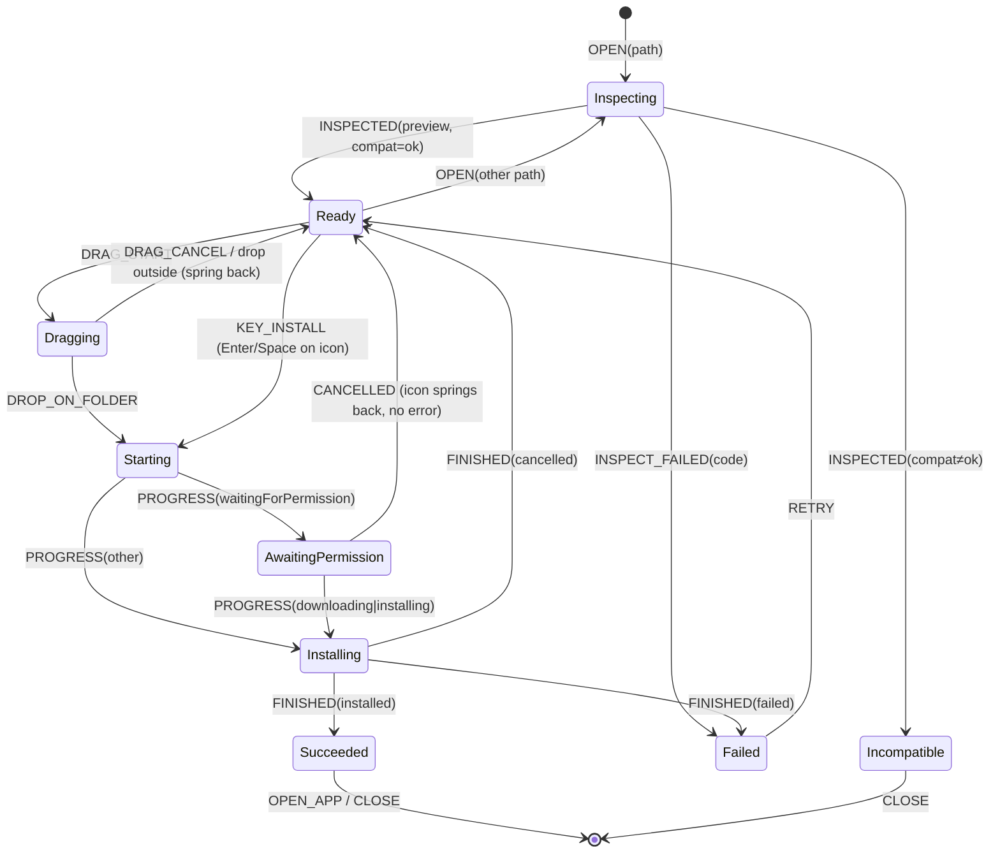
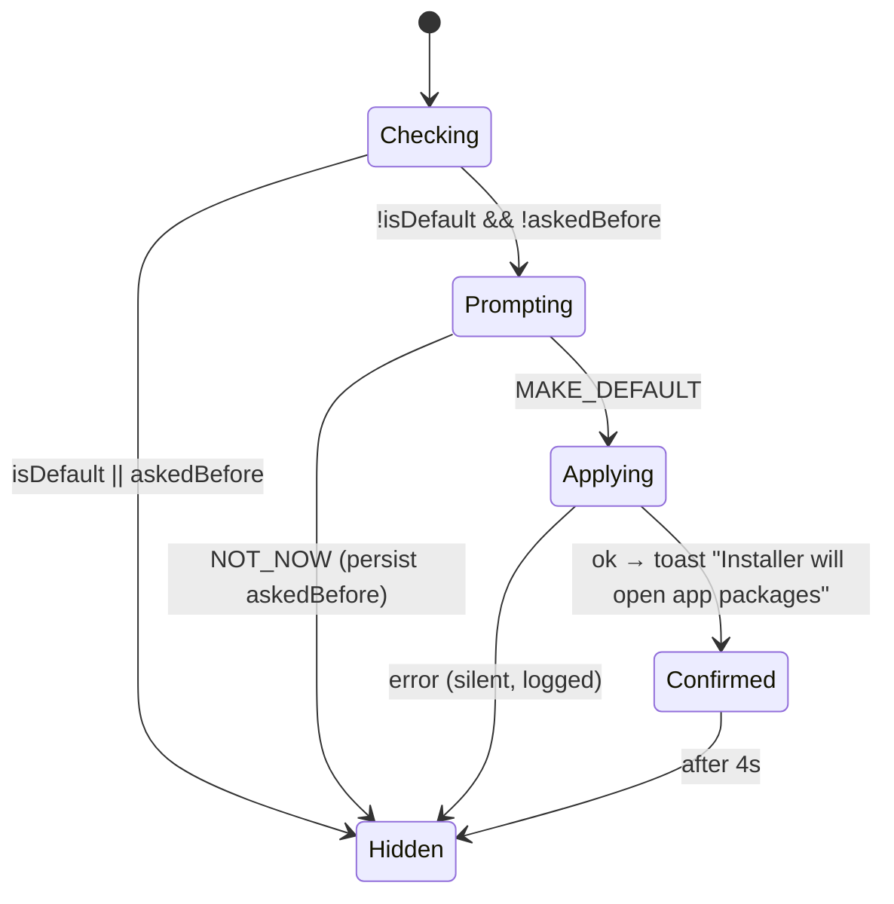
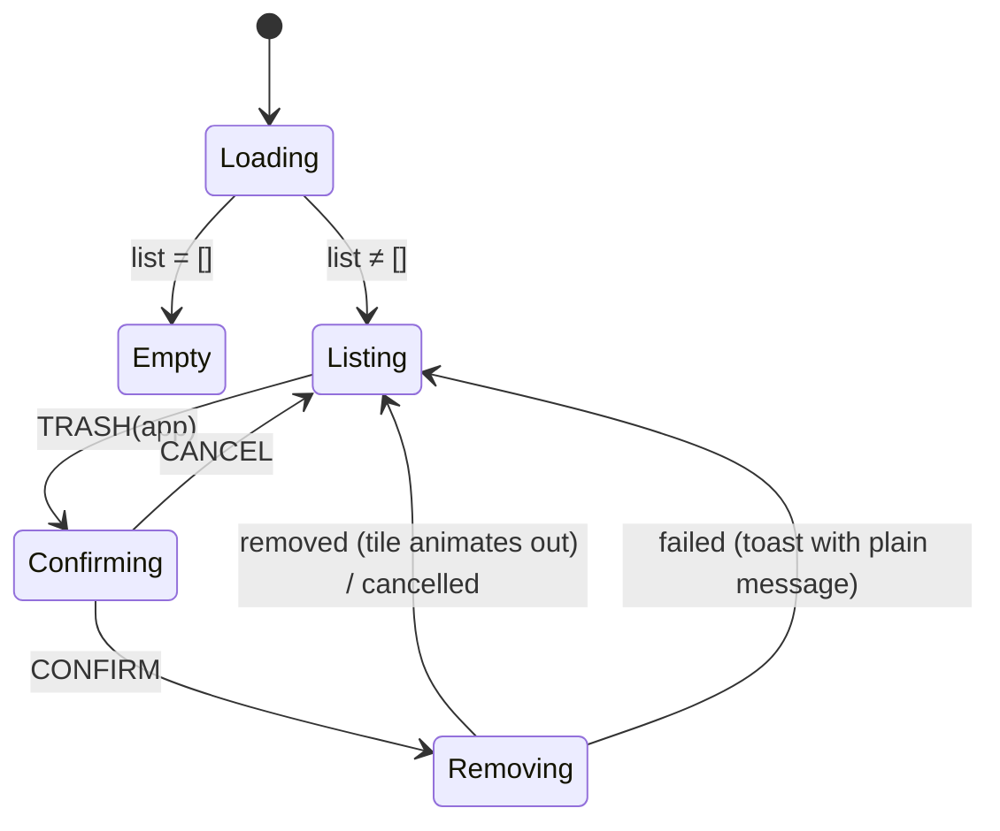

# State Machines

The UI's behaviour lives in pure reducers in `src/lib/core/domain/*-machine.ts`. They are unit-tested exhaustively and contain no timers, IO or Svelte code. Controllers (`*.svelte.ts`) keep the state in `$state` and translate gestures and gateway callbacks into events.

## Installer window



`Incompatible` sub-kinds: `alreadyInstalled.same` shows "Already installed" with an **Open** button; `alreadyInstalled.older` shows "A newer version is already installed"; `alreadyInstalled.newer` is not incompatible at all, it means **Update**: the state stays `Ready` and the folder label becomes "Update".

### State shape

```ts
type InstallerState =
  | { tag: 'inspecting'; path: string }
  | { tag: 'ready'; preview: PackagePreview; queued: string[] }
  | { tag: 'dragging'; preview: PackagePreview; overFolder: boolean }
  | { tag: 'starting' | 'awaitingPermission'; preview: PackagePreview }
  | { tag: 'installing'; preview: PackagePreview; phase: InstallPhase; percent: number | null; etaSecs: number | null; plan?: Plan }
  | { tag: 'succeeded'; preview: PackagePreview; app: InstalledApp }
  | { tag: 'incompatible'; preview: PackagePreview }
  | { tag: 'failed'; preview: PackagePreview | null; code: ErrorCode; detail: string | null };
```

Invariants (test them):
- You can't leave `starting`, `awaitingPermission` or `installing` through user gestures except **Cancel** (when `AllowCancel` is true).
- `OPEN` while installing appends to `queued`. It never replaces the preview.
- Progress `percent` never goes backwards within a phase. The reducer clamps it. PackageKit reports 101 for "unknown", which becomes `null` and the bar turns indeterminate.

## First-launch default prompt



The sheet is shown **after** the package is inspected, and never on top of the permission shade or an active install.

## Library (installed apps)


